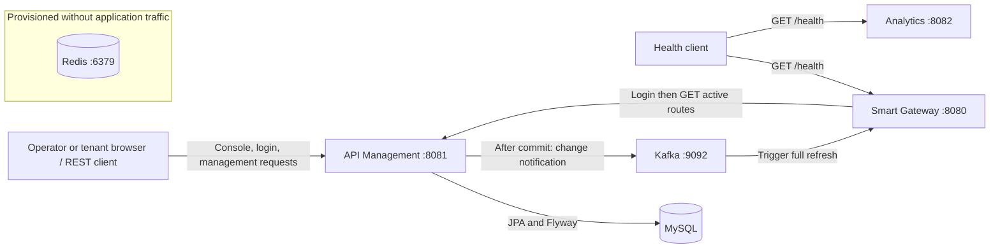
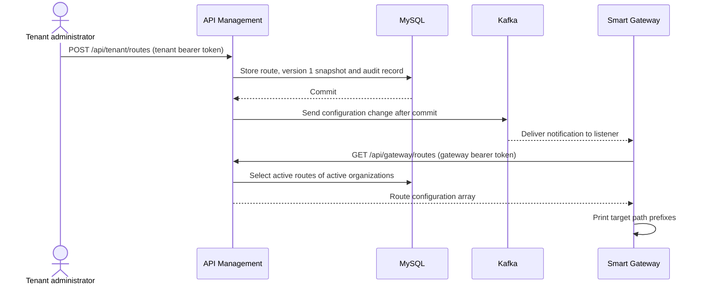

# GateKeeper – Custom API Gateway

[Architecture](#system-architecture) · [Local setup](#installation-and-setup) · [API reference](#api-documentation) · [Testing](#testing)

## Project overview

GateKeeper separates **who may configure an API** from **how a gateway discovers that configuration**. A platform operator can onboard organizations, a tenant administrator can maintain that organization's routes, and a gateway process can retrieve the active configuration without redeployment. This addresses a common problem in shared API platforms: changing one tenant's integration should not require editing every gateway's configuration by hand.

**Implementation boundary:** the management API and configuration notification flow are implemented. The Smart Gateway fetches routes and prints their target path prefixes; it does **not** match or forward incoming traffic. Analytics currently exposes health information, not traffic reports.

## Key features

- Browser-based management console and JSON API for organizations, tenant administrators and routes.
- BCrypt password verification and role-based management endpoints protected by signed JWTs. Tenant operations derive the organization from the token, not a caller-supplied tenant ID.
- Versioned route configuration, including methods, header rules, timeout, rate and idempotency settings. These are **configuration data**, not enforced traffic policies.
- Tenant-visible configuration history and control-plane audit records.
- Startup and Kafka-triggered refresh of active routes. Public service health endpoints, including a database check in management.

## Technology stack

| Component | Version or implementation | Use |
|---|---|---|
| Java / Spring Boot | JDK 21 / Boot 4.1.1 | Three independent Spring MVC applications |
| Spring Security | Boot-managed; OAuth2 Resource Server in management | HS256 bearer tokens and role checks |
| Spring Data JPA / MySQL | Hibernate, MySQL Connector/J, Flyway | Management persistence and SQL migrations; MySQL server version not pinned |
| Spring Data Redis | Gateway starter; `redis:8-alpine` | Infrastructure provisioned; no application cache or limiter |
| Spring for Apache Kafka | `apache/kafka:4.4.0` in Compose | Configuration change notifications |
| Spring Data MongoDB | Analytics starter | Dependency only; no document model or queries |
| Maven | Per-service POM and Spring Boot Maven plugin | Compile, test and package |
| Docker Compose | Root `compose.yaml` | Local Redis and Kafka |
| Testing | JUnit Jupiter, Spring Boot Test; H2 in management test scope | Context smoke tests; MySQL-compatible in-memory test configuration |

## System architecture



## Project structure

Selected packages and resources, grouped by service:

```text
.
├── compose.yaml                                  # Local Redis and Kafka
├── smart-gateway-service/
│   └── src/main/java/in/coderarmy/gatekeeper/gateway/
│       ├── client/                               # Management API client
│       ├── config/
│       ├── controller/
│       ├── dto/
│       ├── event/                                # Configuration notifications
│       └── service/                              # Route refresh
├── api-management-service/
│   ├── Jenkinsfile                               # Management CI/CD pipeline
│   └── src/
│       ├── main/
│       │   ├── java/in/coderarmy/gatekeeper/management/
│       │   │   ├── config/
│       │   │   ├── controller/
│       │   │   ├── dto/
│       │   │   ├── entity/
│       │   │   ├── event/
│       │   │   ├── exception/
│       │   │   ├── repository/
│       │   │   └── service/
│       │   └── resources/
│       │       ├── db/migration/                 # Flyway schema and seed SQL
│       │       └── static/                       # Management console
│       │           ├── index.html
│       │           ├── styles.css
│       │           └── app.js
│       └── test/resources/application.properties
└── analytics-service/
    └── src/main/java/in/coderarmy/gatekeeper/analytics/
        ├── config/
        ├── controller/
        └── dto/responseDto/
```

Each service is a standalone Maven project with its own `pom.xml` and `src/main/resources/application.properties`. There is no root Maven build. The root [Compose file](compose.yaml) starts Redis and Kafka only.

| Service source | Where to look |
| --- | --- |
| [Smart Gateway](smart-gateway-service/src/main/java/in/coderarmy/gatekeeper/gateway) | `client/` calls the management API; `event/` receives Kafka notifications; `service/` reloads the route list. |
| [API Management](api-management-service/src/main/java/in/coderarmy/gatekeeper/management) | `controller/` defines the REST API, `service/` implements tenant and route operations, and `entity/` and `repository/` map those operations to MySQL. |
| [Analytics](analytics-service/src/main/java/in/coderarmy/gatekeeper/analytics) | `controller/` exposes the health endpoint, `dto/responseDto/` defines its response, and `config/` configures access. |

**Management resources**

- [Database migrations](api-management-service/src/main/resources/db/migration/) — Flyway schema and seed SQL, in execution order.
- [Web console](api-management-service/src/main/resources/static/) — HTML, CSS and JavaScript served by the management application.
- [Test configuration](api-management-service/src/test/resources/application.properties) — H2 settings for management tests.
- [Jenkinsfile](api-management-service/Jenkinsfile) — build, test, package and deployment stages.

## Microservices

### Smart Gateway Service · 8080

`GatewayConfigurationLoader` runs at startup. `ManagementApiClient` uses Spring `RestClient` to log in, verifies the returned role is `GATEWAY_SERVICE`, and fetches the active route list. It reuses the token, renews it near expiry and retries the route lookup once on HTTP 401. `ConfigurationEventConsumer` invokes the same loader on notifications. The fetched list is local to the refresh call; there is no serving route table. The gateway security chain permits all requests; the gateway's bearer token authenticates its **outbound** management calls.

### API Management Service · 8081

Controllers validate request DTOs and delegate to transactional services backed by JPA repositories. `OrganizationService` handles onboarding and tenant-admin accounts; `RouteService` manages tenant routes and snapshots. `TenantContext` resolves the JWT organization claim and checks that the organization is active. The gateway feed includes only active routes of active organizations. The static console at `/` uses the same management API.

### Analytics Service · 8082

The controller returns the configured service name, description and an `UP` status. Security permits `/health` and requires authentication elsewhere. Despite the Kafka and MongoDB starters, there is no access-event listener, storage repository or analytics query endpoint.

## Installation and setup

1. Install a **JDK 21** distribution, set `JAVA_HOME` to it and add its `bin` directory to `PATH`. Install Apache Maven (e.g. Maven 3.9.x) and add its `bin` to `PATH`. Use installed Maven: wrapper scripts are present but `.mvn/wrapper` configuration is not tracked. Install Docker Desktop with Compose, or Docker Engine and the Compose v2 plugin. Install/start MySQL separately and have a MySQL client available.

   ```sh
   java -version
   mvn -version  # should report Java 21
   docker compose version
   ```

2. Clone into a conveniently named directory. Run subsequent commands from its root.

   ```sh
   git clone https://github.com/Karankumarweb/Custom-API-Gateway-built-using-Spring-Boot-and-Microservices-Architecture..git gatekeeper
   cd gatekeeper
   docker compose up -d redis kafka
   docker compose ps
   ```

3. Create the management database. Give the application database user schema migration and read/write permissions on this database. Flyway creates the tables, not the database.

   ```sh
   mysql -u root -p -e 'CREATE DATABASE IF NOT EXISTS gatekeeper_management;'
   ```

   Set the following in the **management process environment** (replace placeholders). The default URL expects MySQL on host port 3306. Override the checked-in demo credentials and signing key; do not commit secrets.

   ```sh
   export SPRING_DATASOURCE_URL='jdbc:mysql://localhost:3306/gatekeeper_management'
   export SPRING_DATASOURCE_USERNAME='<database-user>'
   export SPRING_DATASOURCE_PASSWORD='<database-password>'
   export SECURITY_JWT_SECRET='<random-secret-of-at-least-32-bytes>'
   ```

   | Environment override | Default | Applies to |
   |---|---|---|
   | `GATEKEEPER_MANAGEMENT_URL` | `http://localhost:8081` | Gateway |
   | `GATEKEEPER_GATEWAY_USERNAME`, `GATEKEEPER_GATEWAY_PASSWORD` | `gateway-service`, `gateway123` | Gateway login to management |
   | `GATEKEEPER_KAFKA_SERVERS` | `localhost:9092` | Management and gateway |
   | `GATEKEEPER_CONFIGURATION_TOPIC` | `gateway-configuration-events` | Management and gateway; must agree |
   | `GATEKEEPER_CONFIGURATION_GROUP` | `smart-gateway-configuration` | Gateway consumer |

4. Package each service. Skip tests on this first build because the gateway context test calls a running management instance.

   ```sh
   for module in api-management-service smart-gateway-service analytics-service; do
     mvn -f "$module/pom.xml" clean package -DskipTests || break
   done
   ```

5. Run each command in a separate terminal. Start management with the environment from step 3 and wait for `/health` to report `dbStatus: UP` before starting the gateway.

   ```sh
   java -jar api-management-service/target/api-management-service-0.0.1-SNAPSHOT.jar
   ```
   ```sh
   java -jar smart-gateway-service/target/smart-gateway-service-0.0.1-SNAPSHOT.jar
   ```
   ```sh
   java -jar analytics-service/target/analytics-service-0.0.1-SNAPSHOT.jar
   ```

   Visit `http://localhost:8081/` for the console. For a local demo, use its Platform login (`platform-admin` / `platform123`), create an organization, set it to `ACTIVE`, then provision its tenant administrator. The seed migration does not create the console's example tenant accounts. Keep demo accounts and infrastructure off public networks.

## API documentation

All three services expose public `GET /health` with no body. Gateway and analytics return `serviceName`, `serviceDescription` and `appStatus`; these responses do not probe dependencies. Management runs `SELECT 1` and returns HTTP 200 even if `dbStatus` is `DOWN`. Example management response:

```json
{"serviceStatus":"UP","dbStatus":"UP","timestamp":"2026-01-01T12:00:00"}
```

All endpoints below use port **8081**. Send JSON bodies with `Content-Type: application/json`. Except for login, supply `Authorization: Bearer <token>` with the indicated role. No controller declares query parameters. `{id}` and `{organizationId}` are numeric primary keys; `{routeId}` is the tenant's string route identifier. Successful reads and updates return 200; creates return 201 and deletes return 204 without a body.

### Login and gateway configuration

| Method and path | Access | Body → result |
|---|---|---|
| `POST /api/auth/login` | Public | `username`, `password` → token response |
| `GET /api/gateway/routes` | `GATEWAY_SERVICE` | None → array of active route objects |

```sh
curl -s http://localhost:8081/api/auth/login -H 'Content-Type: application/json' \
  -d '{"username":"platform-admin","password":"platform123"}'
```

```json
{"token":"<signed-jwt>","tokenType":"Bearer","expiresInSeconds":3600,"role":"PLATFORM_ADMIN","organizationId":null}
```

### Platform administration

Base: `/api/platform/organizations` · Role: `PLATFORM_ADMIN`. Append the suffix shown; `—` means the base itself.

| Method | Suffix | JSON body | Result |
|---|---|---|---|
| POST | — | `name`, `slug` | New organization (initially `PENDING`) |
| GET | — | None | Organization array |
| GET | `/{id}` | None | Organization |
| PUT | `/{id}` | `name`, `slug` | Updated organization |
| PATCH | `/{id}/status` | e.g. `{"status":"ACTIVE"}` | Organization; use DELETE for `DELETED` |
| DELETE | `/{id}` | None | Soft delete |
| POST | `/{organizationId}/tenant-admin` | Admin credentials | New admin |
| GET | `/{organizationId}/tenant-admin` | None | Admin |
| PUT | `/{organizationId}/tenant-admin` | Admin credentials | Updated admin |
| DELETE | `/{organizationId}/tenant-admin` | None | No body |

Slugs use lowercase alphanumerics separated by single hyphens. Admin credentials contain `username`, `password` (8–100 characters) and optional `enabled` (default `true`). Example admin response: `{"id":3,"organizationId":1,"username":"acme-admin","enabled":true}`.

### Tenant administration

Base: `/api/tenant` · Role: `TENANT_ADMIN` in an active organization.

| Method | Suffix | JSON body | Result |
|---|---|---|---|
| GET | `/organization` | None | Own organization |
| PUT | `/organization` | `{"name":"Acme"}` | Updated organization |
| POST | `/routes` | Route input below | Created route |
| GET | `/routes` | None | Own routes as an array |
| GET | `/routes/{id}` | None | Route |
| PUT | `/routes/{id}` | Route input; `routeId` cannot change | Updated route |
| PATCH | `/routes/{id}/status` | `{"active":true}` | Updated route |
| DELETE | `/routes/{id}` | None | No body |
| GET | `/route-versions/{routeId}` | None | Version array with change type, version number and snapshot |
| GET | `/audit-records` | None | Audit array with actor, action, resource, correlation ID, duration and result |

Example route input for organization slug `acme`:

```json
{
  "routeId": "orders", "name": "Orders API", "pathPattern": "/acme/orders/**",
  "targetBaseUrl": "https://orders.example.com", "targetPathPrefix": "/orders",
  "allowedMethods": ["GET"], "requestsPerMinute": 60, "responseTimeoutMs": 1500,
  "idempotencyEnabled": false, "active": true,
  "headerRules": [{"direction":"REQUEST","action":"ADD","headerName":"X-Tenant","headerValue":"acme"}]
}
```

The path must start with `/<tenant-slug>/`, the target prefix with `/`, and the target URL must use HTTP(S). Supply at least one allowed method and a positive timeout; the optional rate must be positive. Rules distinguish `REQUEST`/`RESPONSE` and `ADD`/`REMOVE`; `ADD` needs a value. Route responses include the configuration plus `id`, `organizationId`, `configurationVersion`, timestamps and IDs for header rules. Request validation errors from management use this shape:

```json
{"status":400,"message":"Request validation failed","errors":{"username":"must not be blank"},"timestamp":"2026-01-01T12:00:00"}
```

## Redis integration

Compose publishes Redis on `6379`; the gateway declares Spring Data Redis. There are no application-defined Redis keys, TTLs, template operations, cache annotations or rate-limit counters. Route refresh reads management over HTTP, not Redis.

## Kafka integration

Management emits `GATEWAY_CONFIGURATION_CHANGED` on route changes and selected organization updates, status changes and deletions. `GatewayConfigurationKafkaPublisher` listens **after transaction commit** and sends a JSON string keyed by `<organizationId>:<routeId>` (or `<organizationId>:organization`). Fields: `eventId`, `eventType`, `changeType`, `organizationId`, `routeId`, `configurationVersion`, `occurredAt`.

The configured topic uses one partition and one replica. The gateway consumes strings with `auto-offset-reset=earliest`; the payload is a signal to refetch **all** active routes, not a patch. An after-commit send is not an atomic database/Kafka write; asynchronous failures are not handled by the publisher callback. No analytics or request-access topic is implemented.

### From a tenant edit to a gateway refresh



MySQL is the source of truth; Kafka signals **when** to read it through the management API. To trace a management change, send an optional `X-Correlation-ID` header. `AuditService` copies it into the audit record rather than generating a new ID.

## Database design

[Flyway migrations](api-management-service/src/main/resources/db/migration) are the schema authority. V1 creates the tables, V2 seeds roles and V3 seeds the platform and gateway accounts. Hibernate validates the migrated schema rather than creating it.

| MySQL tables | Relationship and purpose |
|---|---|
| `organizations` | Unique name and slug; lifecycle `PENDING`, `ACTIVE`, `SUSPENDED`, `DELETED` |
| `roles`, `management_users` | Each user references one role and optionally an organization. Unique username and unique non-null organization association; passwords stored as hashes |
| `api_routes` | Many per organization; unique `(organization_id, route_id)` |
| `route_allowed_methods`, `route_header_rules` | Children of the numeric route key; cascade on route deletion |
| `route_configuration_versions` | Organization-scoped snapshots, unique by organization, route identifier and version number |
| `control_plane_audit_records` | Management operation history linked to the organization, distinct from end-user access logs |

No MongoDB collections or analytics schema are defined.

## Testing

`SmartGatewayServiceApplicationTests` and `AnalyticsServiceApplicationTests` each contain one JUnit Jupiter `contextLoads()` test annotated with `@SpringBootTest`. Neither asserts routing or analytics behavior. Management has H2 test properties but no tracked Java test class. With Kafka and management available for the gateway startup runner:

```sh
mvn -f api-management-service/pom.xml test
mvn -f smart-gateway-service/pom.xml test
mvn -f analytics-service/pom.xml test
```

For a manual configuration-flow check, create an active tenant route through the console and inspect the gateway log for a notification and the route's target path prefix. Calling the configured path on port 8080 is **not** a forwarding test at this stage.

## Docker deployment

[compose.yaml](compose.yaml) runs **infrastructure only**: one Redis container and one Kafka KRaft broker/controller. Kafka advertises `localhost:9092` to host clients; its controller listener is internal on 9093. There are no application images, MySQL/MongoDB services or explicitly configured persistent volumes. This plaintext, single-node setup is for local development.

```sh
docker compose up -d
docker compose logs --tail=50 kafka
docker compose stop     # retain containers
docker compose down     # remove containers and the Compose network
```

## Screenshots and architecture diagrams

See [System architecture](#system-architecture) for the rendered Mermaid diagram. No application screenshots are tracked. Suggested capture: the management console showing an active tenant and its routes. Reserved relative path: `docs/screenshots/management-console.png` (placeholder, not a shipped image).

## Future enhancements

Suggestions, **not implemented commitments**:

- Build a forwarding handler and atomically replace its route table after a successful refresh.
- Enforce configured timeouts, header rules and rate limits; use Redis for shared counters and idempotency state.
- Publish access events and implement analytics ingestion, retention and tenant-scoped reporting.
- Add integration tests for tenant isolation and refresh failures; consider an outbox for reliable change delivery and a refresh strategy for multiple gateway instances sharing one consumer group.

## Contribution guidelines

Describe the use case or bug before proposing a large change. Keep pull requests scoped to one concern; identify affected modules, include reproduction or verification steps, and add tests for behavior changes. For API or persistence changes, update the contract examples and supply a new Flyway migration rather than editing an applied migration. Never include real credentials, tokens or tenant data in fixtures or screenshots.

## Author and license

**Karan Kumar** (repository commit attribution) · [Karankumarweb](https://github.com/Karankumarweb). Design reference: *GateKeeper — Custom API Gateway with Spring Boot*, Lecture 1 architecture notes (Coder Army). The notes describe a target architecture; the implementation sections above describe this checkout.

No license file is tracked and the Maven license entries are empty; no project license is declared.
